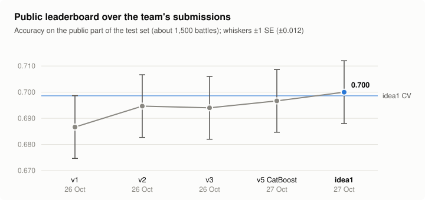

<sub>Photo: ["Pikachu Parade"](https://commons.wikimedia.org/wiki/File:Pikachu_Parade_(14905092432).jpg) by Yoshikazu Takada, [CC BY 2.0](https://creativecommons.org/licenses/by/2.0/), via Wikimedia Commons, cropped.</sub>

# fds-pokemon-challenge
Machine learning project for the FDS 2026/27 Kaggle challenge at Sapienza University of Rome: predicting Pokémon battle outcomes from the first 30 turns.

The solution rebuilds what the battle timeline hides (Player 2's knockouts) and gives the model
Player 1's history across battles. It was called idea1 during development.

## Result

- **CV 5-fold × 3 repeats: 0.6986** with seed 2026, and 0.6985 with seed 7.
- **+0.0138 ± 0.0035** over a reference built like the earlier experiments, on the same folds. The
  reference takes the state at face value and adds species, items and moves, with no knockout
  correction and no history. With seed 7 the gap is +0.0174 ± 0.0055. The earlier autoresearch
  loops had stalled between 0.670 and 0.681.
- **Public leaderboard: 0.70000.** This is a single submission, sent on 27/10
  (`idea1_v4_hiddenKO_history.csv`, identical to `outputs/kaggle/submission.csv`). The previous best
  was 0.69666. The public part covers about 1,500 battles, so its standard error is about ±0.012 and
  the +0.003 over the previous best is within noise. What matters is that the public score confirms
  the CV estimate.
- **Tested on Kaggle** in a private kernel (version 4), which ran the same code as a single script.
  Kaggle gave the same numbers as the local run fold by fold, and the same `submission.csv`, in
  4.3 minutes on 4 CPUs. `src/` is that script split into modules; the split has not been re-run.



Differences between configurations are paired comparisons on the same folds. The standard error is
the Nadeau-Bengio corrected one: √((1/J + 0.25)·var(d)), with J = 15 folds.

## What the data hides

1. **Player 2's knockouts do not show.** P2's `fnt` state appears only in a double KO
   (4,950 of 5,040 cases) or at record 30, when P2 has no Pokémon left (90 cases, all won by P1).
   P2's Explosions show only when P1's Pokémon faints too (2,279 cases against 1).
   The other P2 knockouts, about one per battle, look like ordinary switches.
2. **Records are not consecutive turns.** Some turns are missing: a P1 Pokémon can appear having
   already used a move in the same record, and Rest sleep lasts 0, 1 or 2 records with similar
   frequency.
3. **Teams come from a shared pool.** 75% of P2's fully revealed teams are identical to a P1 team in
   train or test.
4. **P1's history matters, P2's does not.** The win rate of the same P1 team in other battles has a
   correlation of 0.137 with the outcome; for P2's team it is 0.039.

The battle JSON is described in [docs/uml/pokemon-data-model.md](docs/uml/pokemon-data-model.md).

## How it works

1. **Hidden P2 knockouts** (`src/hidden_ko.py`). A "vanishing" is a Pokémon that leaves the field
   and never comes back within the 30 records. P1's knockouts always show, so P1's vanishings are all
   real switches and act as the control group.
   - A LightGBM classifier tells P2 vanishings from P1 ones using a description of the event:
     - the HP, status and last HP drop of the Pokémon that leaves;
     - the KO signature, and whether the replacement came in unhurt (Spikes aside);
     - the base power of both sides' moves;
     - the opponent's HP drop, which catches Explosions.
   - From q = P(P2 | event) it gets P(KO | event) = 1 − c·(1 − q)/q. Predictions are out-of-fold by
     battle and averaged over 3 splits. The constant c ≈ 1.12 makes the total match the excess of
     P2 vanishings over P1 ones.
   - It uses no labels.
   - **Symmetry check:** estimated P2 knockouts (visible plus hidden) per record range are 0.331,
     0.547 and 0.729, against 0.342, 0.580 and 0.764 for P1. In total that is 1.61 against 1.69.

   

2. **Corrected state at record 30** (`src/features.py`). Expected Pokémon alive, expected HP,
   healthy and nearly fainted Pokémon, and statuses, all weighted by the probability of still being
   in play. On top: HP, status, boosts and effects of both active Pokémon, and Spikes on each side.
3. **P1's history** (`src/history.py`). Out-of-fold target encoding of P1's exact team (species
   only, and species plus items), computed inside every CV fold, plus how often the team appears in
   train and test.
4. **Identity, as in the earlier experiments.** P1's species and items, and P1-minus-P2 move counts.
5. **Model** (`src/models.py`). LightGBM with 700 trees, learning rate 0.02, 12 leaves,
   `colsample_bytree` 0.4 and `reg_lambda` 2.

## Ablation (seed 2026)


| configuration | features | CV | vs A (paired, ±SE) |
|---|---:|---:|---:|
| A state at face value | 132 | 0.6753 | — |
| B state with hidden knockouts | 134 | 0.6890 | +0.0137 ± 0.0046 |
| C B + P1 history | 138 | 0.6961 | +0.0208 ± 0.0040 |
| D C + P2 bench | 360 | 0.6939 | +0.0186 ± 0.0045 |
| R reference built like the earlier experiments | 378 | 0.6849 | +0.0096 ± 0.0052 |
| F final without history | 380 | 0.6969 | +0.0216 ± 0.0046 |
| G final without hidden knockouts | 382 | 0.6871 | +0.0118 ± 0.0046 |
| H final + P2 bench | 606 | 0.6982 | +0.0229 ± 0.0040 |
| I final, logistic regression | 384 | 0.6933 | +0.0180 ± 0.0055 |
| **E final** | **384** | **0.6986** | **+0.0233 ± 0.0050** |

Contributions measured on the final model:


| block | contribution |
|---|---:|
| hidden knockouts (E − G) | **+0.0115 ± 0.0029** |
| P1 history (E − F) | +0.0017 ± 0.0035 |
| P2 bench (H − E) | −0.0004 ± 0.0035 |
| LightGBM over logistic regression (E − I) | +0.0054 ± 0.0050 |

Almost all of the gain comes from the hidden knockouts. P1's history helps a lot when the identity
features are missing (C − B = +0.007), but on the final model it overlaps with species and moves and
stays within noise. P2's bench (`src/team_pool.py`) does not help, so the final model leaves it out;
D and H still measure it. In LightGBM's gain, the knockout-corrected features weigh 58% and the move
counts 16%. Another 16% goes to the part of the state that does not depend on the correction (active
Pokémon, Spikes, visible knockouts).

## What did not work

Separate agents explored the variants in parallel, on the same folds. Each proposal was then checked
on new folds (seed 7).

- **A 12-cell knockout calibration** (HP range × KO signature × record range): this was the first
  version. The block was worth +0.003 on the full model; with the classifier it is worth +0.012.
- **A Gen 2 damage estimate inside the calibrator**: no gain (−0.0004 ± 0.0024).
- **Seven more families of state features**, all within noise (the best was +0.0026 ± 0.0024):
  - sleep and toxic counters;
  - Rest versus inflicted sleep;
  - matchups of the remaining teams;
  - the HP trajectory;
  - number of switches;
  - Leftovers;
  - how long Spikes have been up;
  - composition of the Pokémon still alive.
- **Models**: more than 35 variants (LightGBM parameters, seed bagging, XGBoost, CatBoost, logistic
  regression, blends), all within ±0.003. The best blend, chosen after the fact, gave
  +0.0034 ± 0.0024.
- **Variants of P1's history**: smoothing from 5 to 40, other keys, per-species encodings and the
  strength of P2's team. All within noise.

## A lesson from the Kaggle test

The first version of the calibrator used `GroupKFold`, which sorts battles with an unstable sort.
Battles with the same number of events therefore landed in different folds on Kaggle (x86) and
locally (ARM), and the test labels changed in 4% of cases. The splits now come from a seeded
permutation (`RandomState`), identical on every platform. Sums over sets of strings also run in a
fixed order.

## Limits and risks

- **Transductive use of the test set.** Test features, never labels, go into the knockout calibrator,
  the team pool and the frequency counts. This is competition data only, but the report should say
  so.
- **Symmetry assumption.** The calibrator assumes that P1 and P2 switch Pokémon the same way. The
  symmetry check supports it, but in the last record range P2's knockouts stay slightly
  underestimated: a recent vanishing cannot yet be told apart from a switch.
- **Missing P2 lead.** If P2's lead leaves on the first turn and never comes back (445 battles out
  of 15,000), it never becomes an event. A knockout of that lead on the first turn is therefore not
  estimated; the code review put it at about 50 cases per 10,000 battles.
- **Team repetition.** P1's history relies on teams repeating. 69% of P1's test teams already appear
  in train, the same rate as within train itself.
- **Delivery.** The final submission requires a public Kaggle notebook that clones this repository.
  That notebook is still to be written, and the repository is private for now.

## How to run

The competition data is not in the repository. Download it into `data/`, which git ignores:

```bash
kaggle competitions download -c fds-pokemon-battles-prediction-2026 -p data
unzip data/fds-pokemon-battles-prediction-2026.zip -d data
```

Then, from the repository root:

```bash
python run.py
```

The pipeline also reads the folder given in `FDS_DATA`. It needs numpy, pandas, scikit-learn and
LightGBM. Options:

| option | effect |
|---|---|
| `--quick` | a single CV repeat |
| `--no-ablation` | only the final model |
| `--configs A,B` | only some ablation configurations |
| `--seed 7` | changes the folds, the calibrator's splits and the model seeds |
| `--jobs 4` | number of LightGBM threads |
| `--out folder` | output folder (default `outputs/local/`, which git ignores) |

From a notebook, for example on Kaggle after cloning the repository:

```python
import sys
sys.path.append('fds-pokemon-challenge')
from src import pipeline
report = pipeline.run(ablation=False)
```

On Kaggle the outputs go to `/kaggle/working`. Nothing is ever submitted.

## Repository layout

| path | content |
|---|---|
| `run.py` | command-line entry point |
| `src/config.py` | constants, model parameters, seeds |
| `src/data.py` | paths, loading, species table, Spikes |
| `src/hidden_ko.py` | hidden P2 knockouts |
| `src/team_pool.py` | P2's bench from the shared team pool (ablation only) |
| `src/features.py` | the feature table, by group |
| `src/history.py` | P1's history (target encoding) |
| `src/models.py` | LightGBM and the logistic-regression reference |
| `src/validation.py` | repeated CV and paired comparisons |
| `src/pipeline.py` | configurations, ablation, final fit, outputs |
| `outputs/kaggle/` | outputs of version 4 on Kaggle: `run.log`, `cv_report.json`, `cv_report.md`, `submission.csv`, `test_probabilities.csv`, `oof_predictions.csv`, `feature_importance.csv` |
| `docs/figures/` | the four README charts (SVG, light and dark), `make_figures.py`, which rebuilds them from `outputs/kaggle/`, and the banner photo (CC BY 2.0, credited at the top) |
| `docs/uml/pokemon-data-model.md` | UML class diagram of the battle JSON |
| `docs/exploration/train-first-500-flattened.xlsx` | the first 500 training battles flattened into three sheets (P1 team, timeline, P2 lead with the label), for exploration; it holds competition data, so remove it before making the repository public |
