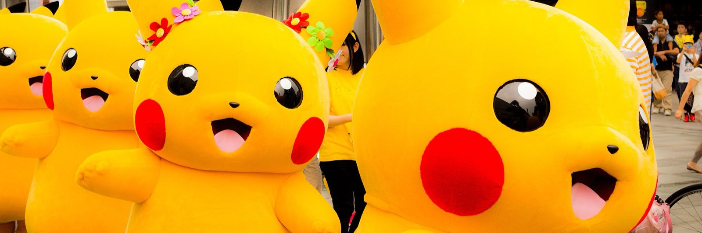
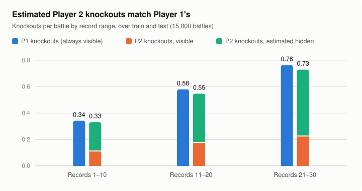
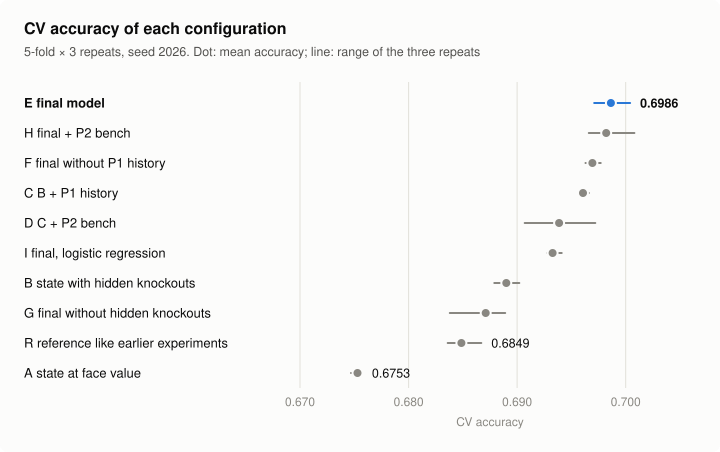
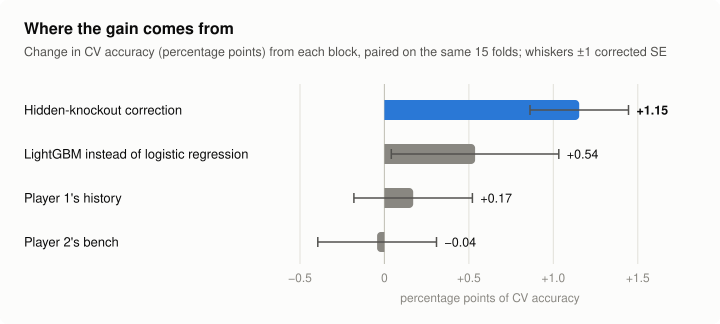

<sub>Photo: ["Pikachu Parade"](https://commons.wikimedia.org/wiki/File:Pikachu_Parade_(14905092432).jpg) by Yoshikazu Takada, [CC BY 2.0](https://creativecommons.org/licenses/by/2.0/), via Wikimedia Commons, cropped.</sub>

# fds-pokemon-challenge

Our solution to the FDS 2026/27 Kaggle challenge at Sapienza University of Rome: predict whether
Player 1 wins a Gen 2 OU Pokémon battle from its first 30 turns. There are 10,000 training battles
and 5,000 test battles, and the metric is accuracy.

**CV accuracy 0.699** (5-fold × 3 repeats) and **0.700 on the public leaderboard**. The same
model without our two additions (the knockout correction and Player 1's history) scores 0.685.

## The idea

The battle log hides two things that decide the outcome:

- **Player 2's knockouts.** A fainted P2 Pokémon is almost never marked as fainted: it looks like an
  ordinary switch. About one P2 knockout per battle is hidden this way.
- **Who Player 1 is.** The same P1 team appears in many battles, and its win rate in the other
  battles predicts the outcome. P2's team does not.

Player 1's knockouts are always visible, so P1's switches show what a real switch looks like. The
difference between P2's and P1's switches gives the hidden knockouts. Once they are added back, P2
loses as many Pokémon as P1 does:



## How it works

The implementation below is in `submissions/01_hidden_ko_history/code/src/`.

1. **Hidden knockouts** (`hidden_ko.py`). For every Pokémon that leaves and never comes back, a
   classifier compares P2's events with P1's and estimates the probability that it was a knockout.
   It uses no labels.
2. **State at turn 30** (`features.py`). Pokémon alive, HP, statuses, the active Pokémon and
   Spikes, with the estimated knockouts removed. On top: P1's species and items, and P1-minus-P2
   move counts.
3. **Player 1's history** (`history.py`). The win rate of P1's exact team in other battles, as
   an out-of-fold target encoding computed inside each CV fold.
4. **Model** (`models.py`). LightGBM.

Every configuration is evaluated with the same 5-fold stratified CV, repeated 3 times. Differences
are paired on the same folds, and ± is the corrected standard error.

## Results





- **Where the gain comes from.** Almost all of it is the knockout correction.
- **Player 1's history** adds little once species and move counts are in.
- **Player 2's estimated bench** adds nothing, so the final model leaves it out.
- **What else was tried.** More state features, XGBoost, CatBoost and blends all stayed within
  noise.

The full numbers are in [outputs/kaggle/cv_report.md](outputs/kaggle/cv_report.md).

## Limits

- The test set's features, never its labels, are used to calibrate the knockout estimate and to
  count teams.
- The estimate assumes that both players switch Pokémon the same way.

## How to run

The three final approaches now have matching folders under [`submissions/`](submissions/README.md).
Use [`final_submissions.ipynb`](final_submissions.ipynb) as the single Kaggle entry notebook.
The notebook runs each approach independently, validates the competition inputs and generated
CSVs, and records the source version and runtime used for each execution.

```bash
pip install -r requirements.txt
kaggle competitions download -c fds-pokemon-battles-prediction-2026 -p data
unzip data/fds-pokemon-battles-prediction-2026.zip -d data
python run.py
```

`run.py` writes `submission.csv` and the CV report to `outputs/local/`, or to `/kaggle/working` on
Kaggle. The full run with the ablation takes about 5 minutes. `--no-ablation` runs only the final
model and `--quick` a single CV repeat; `python run.py --help` lists every option. The `data/`
folder is git-ignored.

From a notebook, after cloning the repository:

```python
import sys
sys.path.append('fds-pokemon-challenge')
from src import pipeline
pipeline.run(ablation=False)
```

## Repository

| path | content |
|---|---|
| `final_submissions.ipynb` | one Kaggle entry notebook for the three approaches |
| `submissions/01_hidden_ko_history/` | hidden-KO + history approach, original source and reference metadata |
| `submissions/02_turn31_v5/` | turn-31 V5 approach, original source and reference metadata |
| `submissions/03_turn31_v2/` | turn-31 V2 approach, original source and reference metadata |
| `submission_tools/` | shared path adaptation, execution and CSV verification |
| `run.py`, `src/` | compatibility entry points for the original first pipeline |
| `outputs/kaggle/` | the run on Kaggle that produced the submission |
| `docs/figures/` | the figures, and `make_figures.py` to redraw them |
| `docs/uml/` | UML diagram of the battle JSON |
