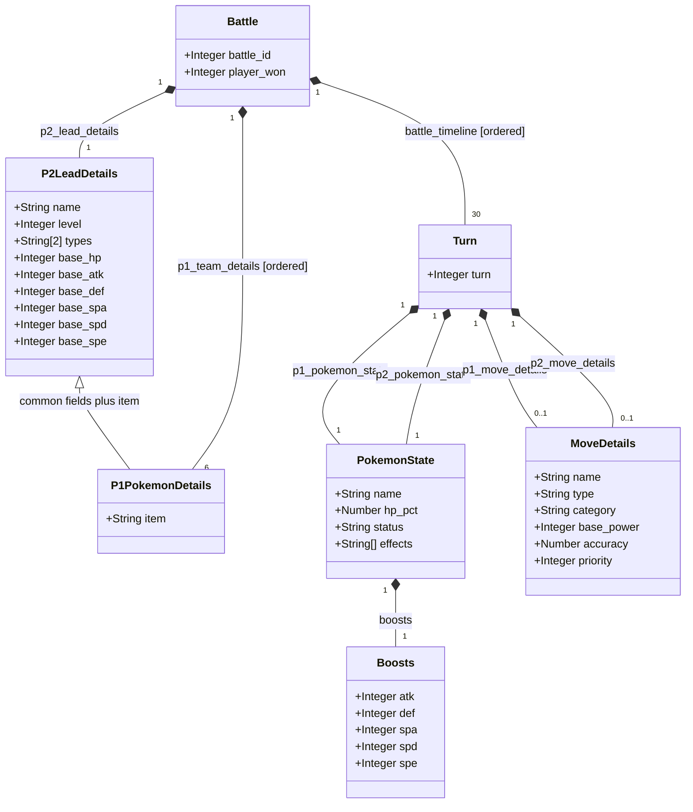

# Pokémon battle JSON: UML class diagram

Source: `train.jsonl` from the FDS: Pokémon Battles Prediction 2026 Kaggle competition. 

This diagram describes the original nested JSON. 

## Legend

| Symbol or notation | Meaning |
|---|---|
| Class box | Describes the fields of a JSON object type. |
| `Integer`, `Number`, `String` | -- |
| `String[2]` | An ordered array containing exactly two strings. |
| `String[]` | An array of strings. |
| Filled diamond (`*--`) | Composition: the object at the diamond end contains the object at the other end. |
| Relationship label | The exact JSON key that contains the nested object or array. |
| `1`, `6`, `30` | Multiplicity: exactly one, six, or thirty contained objects. |
| `0..1` | One object or `null`. Both move keys are present in every turn; their values may be `null`. |
| `[ordered]` | Array order must be preserved. |
| Hollow triangle (`<|--`) | Generalization: `P1PokemonDetails` includes all fields of `P2LeadDetails` and adds `item`. |
## Field guide

| Field | Interpretation |
|---|---|
| `battle_id` | Integer battle identifier. |
| `player_won` | Training target, stored as integer `1` for a P1 win and `0` for a P1 loss. It belongs directly to `Battle`.  |
| `name` | Pokémon species name, or move name inside `MoveDetails`. |
| `level` | Pokémon level. |
| `types` | Two type strings. `notype` is a placeholder for an absent type and can occur in either array position. |
| `base_hp` | Base hit points. |
| `base_atk`, `base_def` | Base physical attack and defense. |
| `base_spa`, `base_spd` | Base special attack and special defense. |
| `base_spe` | Base speed. |
| `item` | Held item. Present in P1 team details; absent from P2 lead details. |
| `turn` | Active turn number in the observed timeline, from 1 to 30. |
| `hp_pct` | Remaining HP as a fraction. |
| `status` | Primary status code, for example `slp`, `par`, or `nostatus`. |
| `effects` | Array of volatile effect codes. All observed training arrays contain exactly one string, including the placeholder `noeffect`. The diagram retains the array representation. |
| `boosts` | Object holding temporary stat stages for `atk`, `def`, `spa`, `spd`, and `spe`. Zero is the neutral stage. |
| Move `type` | Elemental type of the move. |
| `category` | Move category: `physical`, `special`, or `status`. |
| `base_power` | Recorded base power of the move. |
| `accuracy` | Recorded move accuracy as a fraction, for example `0.85`. |
| `priority` | Move priority. |

